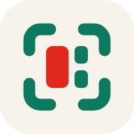

<p align="center">
  
</p>

<h1 align="center">Serangkai</h1>

<p align="center">
  <strong>A self-hosted workspace where you and your AI agents publish interactive work.</strong>
</p>

<p align="center">
  <a href="https://serangkai.onrender.com">Live demo</a> ·
  <a href="#quick-start">Quick start</a> ·
  <a href="#connect-an-ai-agent">Connect an agent</a> ·
  <a href="docs/authoring/README.md">Authoring docs</a>
</p>

<p align="center">
  <a href="https://github.com/sewadahapp/serangkai/actions/workflows/verify.yml"></a>
  <a href="https://github.com/sewadahapp/serangkai/releases"></a>
  <a href="LICENSE"></a>
</p>

Agents write reports, dashboards, small HTML apps, diagrams, and charts straight
into Serangkai over MCP. You browse, organize, edit, and share them from a web
UI on your own server. Everything is private by default, and every agent works
under scoped, revocable permissions.

[](https://github.com/user-attachments/assets/1a2b5a60-8400-4256-a504-f0d41b9c55fa)

> **Try the demo:** sign in at [serangkai.onrender.com](https://serangkai.onrender.com)
> with username `serangkai` and password `serangkai`. It's a shared, disposable
> sandbox, so don't store anything sensitive there. The first load can take a
> moment on Render's free tier.

## Why Serangkai?

Work an agent produces usually stays inside the chat that made it. Serangkai
gives it a home you control: each piece of work is a **rangka**, with its own
page, folder, version history, and optional share link.

It's for:

- **People who ask agents to build things** (a report, a dashboard, a small
  tool) and want the result to live somewhere permanent.
- **Agent builders** who need a real place for agents to read and write, with
  OAuth 2.1 and scoped, revocable tokens rather than a shared password.
- **Self-hosters** who want one container, SQLite and local files by default,
  and no external services.

> **What's a rangka?** A document, file, or interactive piece of work saved in
> Serangkai. The word is the same for one or many, and it's used everywhere: in
> the UI, the REST API, and the MCP tools. Asking an agent to "create a rangka in
> Serangkai" tells it exactly where the work should go.

## Features

- ✨ **Beautiful by default.** Markdown renders with polished Selaras styling:
  tables, callouts, cards, tabs, timelines, Mermaid diagrams, and charts, with
  no CSS or JavaScript from the agent.
- 🎨 **Interactive when you need it.** HTML rangka and static web apps run your
  own code in a sandboxed iframe, as a document, a full-screen app, or a
  zoomable canvas such as a kanban board or whiteboard. Interactive rangka can
  save what people change, like moved cards, without publishing a new version.
- 🤖 **Built for agents.** MCP is built in. Agents sign in through the browser
  or a device code, discover what they can publish, and write only within the
  scopes you approve.
- 🗂️ **An organized workspace.** Nested folders, search, version history with
  restore, and a name for every connected agent.
- 🔒 **Private by default.** Share a rangka publicly or as an unlisted link only
  when you choose to.
- 🖌️ **Themeable.** Serangkai, Rosé Pine, Flexoki, and Catppuccin palettes,
  each in light and dark mode. HTML rangka can follow the active theme.
- 🚀 **Simple to host.** One container with SQLite and local files. Optionally
  use Turso, S3-compatible storage such as Backblaze B2, or Cloudflare Workers.

## Quick start

Run the published image with Docker:

```bash
docker run -d -p 3000:3000 \
  -v serangkai-data:/data \
  -e ADMIN_USERNAME=admin \
  -e ADMIN_PASSWORD='choose-a-strong-password' \
  -e JWT_SECRET=$(openssl rand -base64 32) \
  -e SHARE_SECRET=$(openssl rand -base64 32) \
  ghcr.io/sewadahapp/serangkai:latest
```

Open `http://localhost:3000` and sign in with that username and password. There
is no sign-up page: each Serangkai instance has a single owner account, defined
by these variables. Everything is stored under `/data`, so the volume mounted
there is the only thing you need to keep.

## Deploy

| Where | How | Updates |
| --- | --- | --- |
| Any server with Docker | The [quick start](#quick-start) above, or [`docker-compose.image.yml`](docker-compose.image.yml) | Pull the new image and restart |
| Render | [](https://render.com/deploy?repo=https://github.com/sewadahapp/serangkai) | Redeploy the image from the Render Dashboard |
| Cloudflare Workers | Fork this repo and import it, following the [Cloudflare guide](docs/deploy-cloudflare.md) | Click **Sync fork** on GitHub |

**Render.** The [Blueprint](render.yaml) deploys the published image with a
persistent `/data` disk, which needs a paid Render plan. Render asks for
`ADMIN_USERNAME` and `ADMIN_PASSWORD` and generates `JWT_SECRET` and
`SHARE_SECRET` for you.

**Cloudflare Workers.** Choose D1 or Turso for the database and R2 or
Backblaze B2 for files. Each combination has its own deploy command, and the
guide walks through every step, including the secrets to add.

Keep `ADMIN_USERNAME`, `ADMIN_PASSWORD`, `JWT_SECRET`, and `SHARE_SECRET` the
same across redeployments: changing a secret signs everyone out or breaks
existing share links. Optional settings such as a storage limit, a reverse
proxy, S3 storage, or Turso are in [Configuration](docs/configuration.md).

## Connect an AI agent

The easiest way: open **Agents** in your Serangkai sidebar and copy the setup
prompt into your agent. It tells the agent how to connect, name the connection,
and check what it can publish.

Every MCP client connects to the same endpoint, `https://<your-host>/api/mcp`,
in one of three ways:

- **Browser sign-in (recommended).** Clients that support OAuth open your
  browser to a consent screen where you approve the requested access. No secret
  is pasted anywhere. Codes use PKCE, and each grant is bound to this server.
- **Device code (headless clients).** For SSH sessions, containers, or CI, the
  client prints a short code. Open `https://<your-host>/oauth/device`, sign in,
  enter the code, and approve.
- **API token.** Create a scoped token in **Settings → API tokens** and pass it
  as a bearer header:

  ```bash
  claude mcp add --transport http serangkai http://localhost:3000/api/mcp \
    --header "Authorization: Bearer $SERANGKAI_API_TOKEN" --scope user
  ```

Use `read` to let an agent browse and `read,write` to let it create and update
rangka. Browser and device sign-ins are capped at `read`/`write`; only a token
you create by hand can have `full` access, which can manage other tokens. Tokens
are hashed at rest and can be revoked at any time. You can rename or disconnect
each agent under **Settings → Connected agents**.

## Authoring

Markdown is rendered with Comark and styled by Selaras, so agents get tables,
task lists, callouts, cards, tabs, timelines, Mermaid diagrams, and declarative
TanStack charts without writing CSS or JavaScript. HTML rangka are self-styled
by default and can opt into the Selaras theme and its design tokens.

Agents discover all of this themselves through `get_rangka_capabilities` and the
`serangkai://guides/*` resources. For people, see the
[authoring docs](docs/authoring/README.md).

## Documentation

| Topic | |
| --- | --- |
| [Configuration](docs/configuration.md) | Environment variables, storage, Turso |
| [Deploy to Cloudflare](docs/deploy-cloudflare.md) | Fork, import, secrets, updates |
| [Authoring](docs/authoring/README.md) | Markdown, components, charts, HTML |
| [Backup and restore](docs/backup-restore.md) | Docker, D1, R2, and B2 |
| [Upgrading](docs/upgrading.md) | Notes for upgrading older installs |
| [Architecture](ARCHITECTURE.md) | How the pieces fit together |
| [Security](SECURITY.md) | Security model and reporting a vulnerability |
| [Releasing](docs/releasing.md) | Tested deployment paths and image publishing |

## Development

Requires **Bun 1.4+**.

```bash
bun install --frozen-lockfile --ignore-scripts
bun run dev        # sign in with admin / serangkai-dev
bun run test:ci
```

See [CONTRIBUTING.md](CONTRIBUTING.md) for conventions, tests, and how to open
a pull request.

## Built with

[Nuxt 4](https://nuxt.com/) and [Nitro](https://nitro.build/) ·
[TypeScript](https://www.typescriptlang.org/) · [Bun](https://bun.sh/) ·
[Selaras](https://selarasui.my.id/) · [Comark](https://comark.dev/) ·
[SQLite](https://www.sqlite.org/) with [Drizzle ORM](https://orm.drizzle.team/)

## License

MIT. See [LICENSE](LICENSE).
