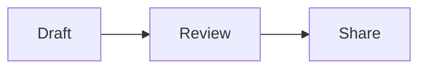

# Markdown

Markdown is parsed once on the server with Comark, sanitized, and styled by
Selaras. Ordinary Markdown already looks finished: use it first, and add
components only when the document needs structure.

```markdown
# Quarterly review

## Highlights

- Revenue grew **18%**.
- Response time fell to **160 ms**.

| Metric | Q1 | Q2 |
| --- | --- | --- |
| Revenue | $1.2M | $1.4M |
```

## Components

Selaras components use block syntax:

```mdc
::s-callout{type="tip" title="What changed"}
The onboarding flow removed two steps.
::

::s-card{variant="soft"}
#header
### Release notes

#default
Everything shipped this week.
::
```

`::s-table` accepts JSON data and columns, `::s-timeline` accepts an items
array, and `::s-tabs` and `::s-accordion` use a named slot per item. The
component catalog resource, `serangkai://components/selaras`, lists every
supported tag with its props and examples.

## Charts

Declarative charts are a fenced block of JSON:

````markdown
```chart
{"type":"bar","title":"Rangka per week","data":[{"week":"W1","value":6},{"week":"W2","value":12}],"x":"week","y":"value"}
```
````

Supported types are bar, line, area, and horizontal bar (`"horizontal": true`).
This is a declarative subset of TanStack Charts, not the full API.

## Mermaid

````markdown

````

## Limits

Markdown is sanitized and never evaluated:

- No author scripts, iframes, event handlers, styles, expressions, or unknown components.
- No `v-model` bindings or arbitrary callbacks.
- Forms, overlays, dashboard shells, and application-state components are not available.
- Links may use `http`, `https`, or `mailto`. Images may not use `data:` URLs.

When you need any of these, write an [HTML rangka](/authoring/html) instead.
