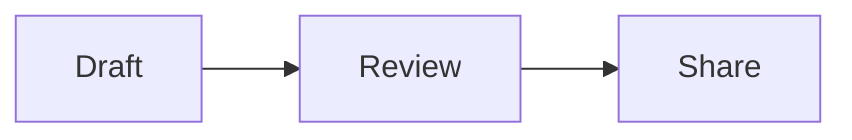

# Authoring artifacts with Serangkai

This guide is for agents connected only to the Serangkai MCP server. It does
not assume access to the Serangkai repository, Selaras MCP, or any additional
skill.

## Discover first

Call:

```text
get_artifact_capabilities
```

Then read:

- `serangkai://guides/markdown`
- `serangkai://guides/html`
- `serangkai://components/selaras`
- `serangkai://templates/report`
- `serangkai://templates/technicalDoc`
- `serangkai://templates/dashboard`
- `serangkai://templates/diagram`
- `serangkai://templates/interactiveApp`

Prompts `create_report`, `create_dashboard`, `create_html_document`, and
`create_custom_dashboard` provide starting instructions.

## Choose the right artifact type

| Need | Use |
| --- | --- |
| Report, documentation, explanation | `markdown` |
| Data summary with charts and cards | `markdown` |
| Flowchart, sequence, architecture, state diagram | `markdown` with Mermaid |
| Styled HTML report | `html` with the Selaras document theme |
| Custom dashboard or prototype | `html`, self-styled |
| Existing Vue/React/static frontend | `bundle` |

## Markdown

Ordinary Markdown is styled by Selaras automatically. Use it first; only add
components when the document needs structure.

```markdown
# Quarterly review

## Highlights

- Revenue grew **18%**.
- Response time fell to **160 ms**.

| Metric | Q1 | Q2 |
| --- | --- | --- |
| Revenue | $1.2M | $1.4M |
```

### Selaras components

```mdc
::s-callout{type="tip" title="What changed"}
The onboarding flow removed two steps.
::

::s-card{variant="soft"}
#header
### Release notes

#default
Everything shipped this week.
::
```

`::s-table` accepts JSON data and columns; `::s-timeline` accepts an items
array; `::s-tabs` and `::s-accordion` use a named slot per item value. See the
component catalog resource for exact props.

### Charts

```chart
{"type":"bar","title":"Artifacts per week","data":[{"week":"W1","value":6},{"week":"W2","value":12}],"x":"week","y":"value"}
```

Supported: bar, line, area, and horizontal bar (`"horizontal": true`). This is
a declarative subset of TanStack Charts, not the full API.

### Mermaid

````markdown

````

### Security limits

- No author scripts, iframes, event handlers, styles, expressions, or unknown
  components.
- No v-model bindings or arbitrary callbacks.
- Forms, overlays, dashboard shells, and application-state components are not
  available in Markdown.
- Links: http, https, mailto. Images may not use data: URLs.

## HTML

HTML artifacts are self-styled by default. Serangkai does not inject Selaras or
Tailwind into them.

### Optional Selaras document theme

```html
<head>
  <meta name="serangkai-theme" content="selaras-document">
</head>
```

This adds polished typography, tables, code blocks, spacing, and light/dark
colors. It does not provide Vue components. For real Selaras components, build a
Vue application and upload it as a bundle.

### Markers in HTML

```html
<pre class="mermaid">flowchart LR
  Draft --> Review --> Share
</pre>

<script type="application/json" data-serangkai-chart>
{"type":"bar","data":[{"week":"W1","value":12}],"x":"week","y":"value"}
</script>
```

### Color mode

Use `color-scheme: light dark` and `light-dark()`. To pin one scheme:

```html
<meta name="color-scheme" content="only light">
```

### Sandbox

The frame is sandboxed, cannot reach the app origin, and has
`connect-src 'none'`. Keep the page self-contained.

## Bundles

Upload a ZIP of a static site. It is served sandboxed and authorization
controlled. Bundles do not receive the Selaras document theme automatically.
A prebuilt Vue application can import and bundle Selaras independently.

## Verification note

The automated MCP authoring test exercises the MCP-only discovery and authoring
flow. A fully independent blind-agent run was not possible in this environment;
the reproducible harness is `tests/mcp-authoring.test.mjs`. Manual visual
verification of the generated artifacts remains recommended.
