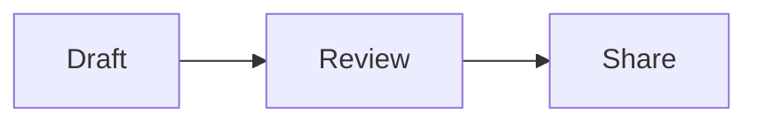

# Authoring rangka with Serangkai

This guide is for agents connected only to the Serangkai MCP server. It does
not assume access to the Serangkai repository, Selaras MCP, or any additional
skill.

## Discover first

Call:

```text
get_rangka_capabilities
```

Then read:

- `serangkai://guides/markdown`
- `serangkai://guides/html`
- `serangkai://components/selaras`
- `serangkai://templates/report`
- `serangkai://templates/technicalDoc`
- `serangkai://templates/dashboard`
- `serangkai://templates/diagram`
- `serangkai://templates/interactiveApp`

Prompts `create_report`, `create_dashboard`, `create_html_document`, and
`create_custom_dashboard` provide starting instructions.

## Choose the right rangka type

| Need | Use |
| --- | --- |
| Report, documentation, explanation | `markdown` |
| Data summary with charts and cards | `markdown` |
| Flowchart, sequence, architecture, state diagram | `markdown` with Mermaid |
| Styled HTML report | `html` with the Selaras document theme |
| Custom dashboard or prototype | `html`, self-styled |
| Existing Vue/React/static frontend | `bundle` |

## Markdown

Ordinary Markdown is styled by Selaras automatically. Use it first; only add
components when the document needs structure.

```markdown
# Quarterly review

## Highlights

- Revenue grew **18%**.
- Response time fell to **160 ms**.

| Metric | Q1 | Q2 |
| --- | --- | --- |
| Revenue | $1.2M | $1.4M |
```

### Selaras components

```mdc
::s-callout{type="tip" title="What changed"}
The onboarding flow removed two steps.
::

::s-card{variant="soft"}
#header
### Release notes

#default
Everything shipped this week.
::
```

`::s-table` accepts JSON data and columns; `::s-timeline` accepts an items
array; `::s-tabs` and `::s-accordion` use a named slot per item value. See the
component catalog resource for exact props.

### Charts

```chart
{"type":"bar","title":"Rangka per week","data":[{"week":"W1","value":6},{"week":"W2","value":12}],"x":"week","y":"value"}
```

Supported: bar, line, area, and horizontal bar (`"horizontal": true`). This is
a declarative subset of TanStack Charts, not the full API.

### Mermaid

````markdown

````

### Security limits

- No author scripts, iframes, event handlers, styles, expressions, or unknown
  components.
- No v-model bindings or arbitrary callbacks.
- Forms, overlays, dashboard shells, and application-state components are not
  available in Markdown.
- Links: http, https, mailto. Images may not use data: URLs.

## HTML

HTML rangka are self-styled by default. Serangkai does not inject Selaras or
Tailwind into them.

### Optional Selaras document theme

```html
<head>
  <meta name="serangkai-theme" content="selaras-document">
</head>
```

This adds polished typography, tables, code blocks, spacing, and light/dark
colors. It does not provide Vue components. For real Selaras components, build a
Vue application and upload it as a bundle.

### Markers in HTML

```html
<pre class="mermaid">flowchart LR
  Draft --> Review --> Share
</pre>

<script type="application/json" data-serangkai-chart>
{"type":"bar","data":[{"week":"W1","value":12}],"x":"week","y":"value"}
</script>
```

### Color mode

Use `color-scheme: light dark` and `light-dark()`. To pin one scheme:

```html
<meta name="color-scheme" content="only light">
```

### Presentation mode

The shared reader sizes HTML to its content, so the page owns the scrollbar and
the footer follows the document.

Full-viewport applications that manage their own layout and scrolling should
opt into a bounded frame instead:

```html
<meta name="serangkai-presentation" content="app">
```

The iframe then fills the space between the shared header and footer and scrolls
internally. Document-style HTML (the default) needs no marker.

For a fixed canvas, declare its width and height in CSS pixels in the HTML head.
Each dimension must be between 240 and 4096 pixels.

```html
<meta name="serangkai-canvas" content="1920x1080">
```

Lay out the full report, dashboard, or design inside that viewport. It opens
fitted to the available space in the workspace and on share links.

- Hold Space and drag to pan, or slide two fingers on a trackpad. **Pan** or
  `H` keeps the hand tool active until you toggle it or press Escape.
- Pinch or hold Ctrl or Command and scroll to zoom toward the pointer.
  Open the zoom percentage menu in the floating controls for preset zoom levels,
  including 100% actual size. Select **Fit** to see the whole board.
- With the canvas focused, the arrow keys pan, `+` and `-` zoom, and
  `0` or Shift+1 fits the board.

Buttons, editable fields, and scrollable regions inside the rangka keep their
usual behavior during normal interaction.

For a slide deck or another HTML app with its own keyboard commands, add this
tag to reserve keys for the app while the frame has focus:

```html
<meta name="serangkai-canvas-keys" content="none">
```

The viewer's toolbar, pointer gestures, and shortcuts with the canvas viewport
focused are still available.

### Saving data from interactions

An HTML rangka that people change by using it, such as a kanban board, can save
that state as **rangka data** through `window.serangkai.data`. Saves happen
immediately, survive a reload, and do not create a new version, so restoring
an older version of the design keeps the data.

```js
const store = window.serangkai.data
const { writable } = await store.info()
const cards = await store.list('cards')
await store.set('cards', 'c1', { title: 'Write notes', column: 'todo', order: 0 })
await store.update('cards', 'c1', { column: 'done' })
await store.remove('cards', 'c1')
```

- Documents are JSON objects of up to 64 KB, grouped into named collections. A
  rangka holds up to 5000 documents and 5 MB of data, and data counts toward
  storage usage.
- The workspace can read and write. Shared pages can read, so a published
  board shows its saved cards, but `writable` is `false` there and writes are
  refused.
- Opened outside Serangkai, every call rejects; fall back to the content in the
  HTML.
- Agents can read and seed the same data with the `read_rangka_data` and
  `write_rangka_data` MCP tools.

The `serangkai://templates/canvasBoard` template is a kanban board that saves
its cards this way.

### Sandbox

The frame is sandboxed, cannot reach the app origin, and has
`connect-src 'none'`. Keep the page self-contained; use `serangkai.data` to
save state.

## Bundles

Upload a ZIP of a static site. It is served sandboxed and authorization
controlled. Bundles do not receive the Selaras document theme automatically.
A prebuilt Vue application can import and bundle Selaras independently.
The `serangkai-canvas` marker also works in a bundle's HTML.

## Verification note

The automated MCP authoring test exercises the MCP-only discovery and authoring
flow. A fully independent blind-agent run was not possible in this environment;
the reproducible harness is `tests/mcp-authoring.test.mjs`. Manual visual
verification of the generated rangka remains recommended.
